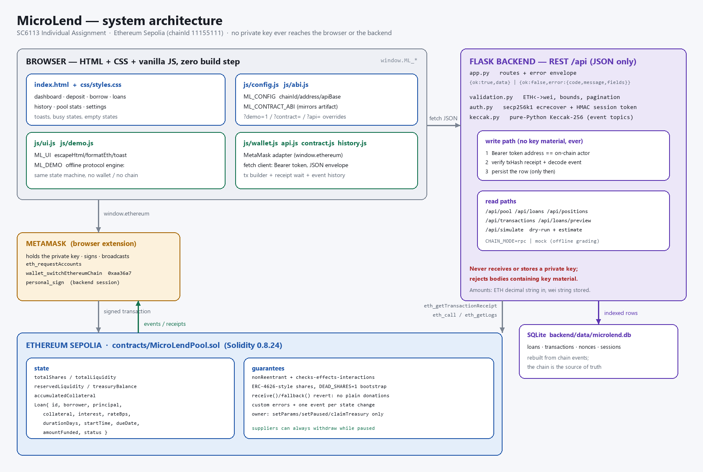

# MicroLend — a peer-to-pool micro-lending DApp

> **Individual Assignment submission**
> **Student:** ZHANG SHUJIA &nbsp;·&nbsp; **Student ID:** G2601577A
> **Course:** SC6113 — Blockchain and Decentralised Applications
> **Report:** `docs/MicroLend-Report.pdf` (5–8 pages) &nbsp;·&nbsp; **Evidence:** `docs/TESTING.md`


**SC6113 Individual Assignment — Financial Decentralised Application**

MicroLend is a decentralised micro-lending protocol on **Ethereum Sepolia**. Liquidity suppliers
deposit ETH into a shared pool and receive **pool shares** that appreciate as borrowers repay
interest; borrowers open small, **over-collateralised** loans by locking ETH collateral, and can be
liquidated if they default. A smart contract holds the money, a Flask backend indexes the chain and
authenticates wallets, and a zero-build vanilla-JS frontend drives MetaMask.

Everything is ETH-denominated, so **no price oracle sits in the critical path** — the deliberate
simplification that makes the accounting auditable (and is documented as a limitation).



---

## Contents

- [What it does](#what-it-does)
- [Architecture](#architecture)
- [Functional requirements → evidence](#functional-requirements--evidence)
- [Tech stack](#tech-stack)
- [Quick start](#quick-start)
- [Repository layout](#repository-layout)
- [REST API](#rest-api)
- [Testing](#testing)
- [Security notes](#security-notes)
- [Limitations](#limitations)
- [Marking rubric → evidence](#marking-rubric--evidence)
- [Licence](#licence)

---

## What it does

| Actor | Capability |
|---|---|
| **Supplier** (lender) | `deposit()` ETH → mints pool shares; `withdraw(shares)` burns them for ETH plus accumulated interest. |
| **Borrower** | `requestLoan(principal, rateBps, durationDays)` with collateral ETH attached. The loan activates instantly if the pool has free liquidity, otherwise it waits in `Pending` for `fundLoan`, or is cancelled with `cancelLoan`. |
| **Anyone** | `liquidate(loanId)` once a loan is past `dueDate` and still `Active`. |
| **Owner** (protocol admin) | `setParams`, `setPaused`, `setTreasury`, `claimTreasury`, `transferOwnership`. No access to user funds beyond the protocol fee. |

**Money maths** (simple interest, frozen at request time, all in wei):

```
interest     = principal * rateBps * durationDays / (10_000 * 365)
baseDue      = principal + interest
fee          = interest * feeBps / 10_000            → treasuryBalance (default 10 % of interest)
supplierGain = interest - fee                        → totalLiquidity  (lifts the share price)

# late repayment, while still Active and now > dueDate
periods      = (now - dueDate) / 30 days + 1
lateFee      = baseDue * lateFeeBps * periods / 10_000
amountDue    = baseDue + lateFee

# liquidation, > dueDate and still Active
owed         = amountDue
collateral >= owed : suppliers get min(owed + owed*penaltyBps/10_000, collateral);
                     the excess collateral is refunded to the borrower; no bad debt
collateral <  owed : suppliers get all collateral; totalBadDebt += owed - collateral
```

Share accounting is ERC-4626-style, written from scratch: the first deposit also parks
`DEAD_SHARES = 1` share on the contract itself, which defeats the classic first-depositor
share-inflation griefing attack (`receive()`/`fallback()` reject plain ETH, so a donation cannot be
used to inflate the share price either).

## Architecture

```
                    ┌──────────────────────────────────────────────────────────────┐
                    │  BROWSER  (vanilla JS, zero build step, no private keys)     │
                    │                                                              │
                    │  frontend/index.html + css/styles.css                        │
                    │  frontend/js/config.js   window.ML_CONFIG   (chain/API cfg)  │
                    │  frontend/js/abi.js      window.ML_CONTRACT_ABI              │
                    │  frontend/js/ui.js       window.ML_UI      (escape/format)   │
                    │  frontend/js/demo.js     window.ML_DEMO    (offline engine)  │
                    └───────┬───────────────────────────────┬──────────────────────┘
                            │ window.ethereum               │ fetch() JSON
                            │ eth_requestAccounts           │ Bearer token
                            │ wallet_switchEthereumChain    │
                            │ personal_sign                 │
                            ▼                               ▼
        ┌───────────────────────────────┐   ┌───────────────────────────────────────┐
        │  METAMASK                     │   │  FLASK BACKEND  (backend/app.py)      │
        │  holds the key, signs + sends │   │  REST /api, JSON only                 │
        └───────────────┬───────────────┘   │  ├── validation.py  wei/ETH, limits   │
                        │                   │  ├── auth.py        secp256k1 ecrecover│
                        │ tx                  │  ├── keccak.py      event topics      │
                        ▼                   │  └── SQLite index (loans, txs,        │
        ┌───────────────────────────────┐   │        nonces, sessions)              │
        │  ETHEREUM SEPOLIA (11155111)  │◄──┤  verifies the submitted txHash,       │
        │  contracts/MicroLendPool.sol  │   │  decodes the matching event, then     │
        │  · shares + liquidity ledger  │   │  persists the row. Never sees a key.  │
        │  · loans, collateral, treasury│   └───────────────────────────────────────┘
        └───────────────────────────────┘
```

**Trust boundaries.** The contract is the only thing that holds money and the only thing that
decides whether a loan is valid. The backend is a *read model*: it cannot move funds, cannot forge a
loan, and refuses to record anything it cannot tie to a transaction hash it verified against the
chain (`CHAIN_MODE=rpc`). The browser never stores key material — signing happens inside MetaMask.

## Functional requirements → evidence

Assignment §VI (Functional Requirements) and §VII (Security Considerations), each mapped to the
code and the test that exercises it.

| # | Requirement | Where it is implemented | Evidence |
|---|---|---|---|
| FR-1 | Connect MetaMask wallet | `frontend/js/wallet.js` — `eth_requestAccounts`, `wallet_switchEthereumChain` (`0xaa36a7`), `personal_sign` for the backend session | `docs/TESTING.md` §Frontend; `node test/run-tests.js`; `docs/SCREENSHOTS.md` S1 |
| FR-2 | Submit blockchain transactions | `frontend/js/contract.js` → `MicroLendPool.deposit/requestLoan/repayLoan/withdraw/liquidate` | contract suite: `deposit/borrow/repay/liquidate` suites |
| FR-3 | Validate requests via smart contracts | `requestLoan` bounds + collateral check; custom errors (spec §2.6) | 42 decoded-revert checks in `docs/TESTING.md` §Error conformance |
| FR-4 | Record transactions on blockchain | one event per state change (`LoanRequested`, `LoanActivated`, `LoanRepaid`, `LoanLiquidated`, …) | contract suite event assertions; backend indexer suite |
| FR-5 | Display confirmation and history | history/portfolio panels in `frontend/js/app.js`, `GET /api/transactions`, `GET /api/positions/<address>` | `docs/TESTING.md` §Endpoint matrix; `docs/SCREENSHOTS.md` S5 |
| SEC-1 | Authentication and authorisation | `backend/auth.py` (nonce → `personal_sign` → HMAC token); `onlyOwner` on-chain | backend pytest `test_auth*`; contract suite access-control asserts |
| SEC-2 | Input validation | `backend/validation.py`; contract `require`-style custom errors | `docs/TESTING.md` §Error conformance + endpoint invalid-request matrix |
| SEC-3 | Smart-contract vulnerabilities | reentrancy guard, CEI ordering, dead-share guard, checked 0.8 arithmetic | `docs/TESTING.md` §Findings; adversarial EVM harness |
| SEC-4 | Private-key protection | no key ever reaches the browser or backend; `.env` holds the deploy key only | `backend/auth.py::reject_private_key_material`; `docs/TESTING.md` §Coverage limits |
| SEC-5 | Gas optimisation | `solc` optimiser `runs: 200`, `evmVersion: shanghai`, custom errors instead of strings | `scripts/compile.js`; gas figures in `docs/TESTING.md` |
| SEC-6 | Data privacy / ethics | testnet only, no personal data stored, addresses are pseudonymous | `docs/REPORT.md` §Limitations |

## Tech stack

| Layer | Choice | Why |
|---|---|---|
| Smart contract | Solidity **0.8.24** (`^0.8.24`), no external imports | checked arithmetic, custom errors, one self-contained file an examiner can read |
| EVM target | `shanghai`, optimiser on, `runs: 200` | deployable on Sepolia today, cheap enough for micro-loans |
| Chain | Ethereum **Sepolia** (`chainId 11155111`) | assignment §V |
| Wallet | **MetaMask** (`window.ethereum`) | assignment §V; keys never leave the extension |
| Frontend | **HTML + CSS + vanilla JavaScript**, no bundler | assignment §V; opens straight from the filesystem, nothing to install |
| Backend | **Flask** (Python), JSON only | assignment §III/§V |
| Crypto in backend | pure-Python Keccak-256 + secp256k1 `ecrecover` (`backend/keccak.py`, `backend/auth.py`) | signature verification without native dependencies |
| Database | **SQLite** (stdlib `sqlite3`) | assignment §V optional database |
| Contract tests | in-process **ganache** + **ethers v6** + **solc-js** (bundled under `.tooling/nm`) | real EVM execution, no network, deterministic |
| Backend tests | **pytest** (bundled under `.tooling/pylibs`) | same |

## Quick start

Prerequisites: Node.js and Python (bundled paths are used by the commands below). **Nothing needs to
be installed** — the toolchain is vendored under `.tooling/`.

### 1. Offline demo mode — 30 seconds, no wallet, no chain

```powershell
# Windows PowerShell, from the repository root
Start-Process "frontend\index.html"          # any browser
# or: python -m http.server 8080 --directory frontend  → http://127.0.0.1:8080/
```

With no wallet or no configured contract address the app boots into **demo mode** (`config.js`
decides this and the topbar says so): `frontend/js/demo.js` runs the whole protocol locally in the
browser so every screen — deposit, borrow, repay, liquidate, history — can be exercised with zero
setup. Force it with `?demo=1`, force chain mode with `?demo=0`.

### 2. Local chain (real EVM, real transactions)

```powershell
node scripts/dev-chain.js                      # ganache on http://127.0.0.1:8545
node scripts/compile.js                        # → artifacts/MicroLendPool.json
node scripts/deploy-local.js                   # deploys + initialises + seeds demo data, prints the address
```

Verified by running it: `chainId 31337`, two seeded supplier deposits (20 ETH + 5 ETH) and two loans
(id 1 `ACTIVE`, id 2 `PENDING`), pool stats 25 ETH liquidity / 24 available / 1 reserved. The contract
address is **written to `deployment.local.json` and is not constant** — it is nonce-dependent on the
chain's history (I observed `0xe78A0F7E…` on a fresh chain and `0x254dffcd…` on a chain that already
held six transactions), so read it from that file rather than copying it. Add `--exit` to deploy, seed
and quit without staying resident (CI-friendly, verified exit 0). The record contains the
**development-only** ganache keys: gitignore it, or redirect it with `LOCAL_DEPLOYMENT_OUT=` (see
`docs/TESTING.md` O-10/O-11).

Then serve the frontend with the address, or point the backend at it:

```powershell
$env:CHAIN_MODE="rpc"; $env:RPC_URL="http://127.0.0.1:8545"
python backend/app.py                          # http://127.0.0.1:5000
```

### 3. Sepolia deployment

```powershell
Copy-Item .env.example .env                    # fill in SEPOLIA_RPC_URL + DEPLOYER_PRIVATE_KEY
node scripts/deploy.js                         # deploys, calls initialize() in the same run, writes .env
# then verify the source on Etherscan under the Contract tab (API-key based; not run here)
```

> **Not executed in this environment.** No Sepolia RPC endpoint, funded test key or Etherscan API
> key is available here, so the Sepolia deployment is *documented and scripted* but **not verified**
> — see `docs/TESTING.md` §Coverage limits for the exact list of what is unverified.

## Sepolia deployment record

The contract is deployed to the Ethereum Sepolia testnet with `scripts/deploy.js`, which
validates the environment, refuses a non-Sepolia chain or an unfunded account, deploys and calls
`initialize(treasury, owner)` in the same run, then writes `deployment.json` and prints the
Etherscan links.

```powershell
Copy-Item .env.example .env      # then fill in the two required values
#   SEPOLIA_RPC_URL=https://sepolia.infura.io/v3/<your-key>
#   DEPLOYER_PRIVATE_KEY=0x<testnet-only key>
node scripts/deploy.js
# dry run first if you prefer:
node scripts/deploy.js --dry-run
```

| Field | Value |
|---|---|
| Network | Ethereum Sepolia (`chainId 11155111`) |
| Contract | `MicroLendPool` |
| Address | [`0xECDaCA02f7646A8182A57c6520318D0FebC8bDCA`](https://sepolia.etherscan.io/address/0xECDaCA02f7646A8182A57c6520318D0FebC8bDCA) |
| Deploy transaction | [`0x759173a5ac316e18…`](https://sepolia.etherscan.io/tx/0x759173a5ac316e187b6c0a62fe27a95353825aaaf68ff2c84787b8f733c15d21) in block 11919472 |
| Source hash | `e26e720a9c2eb75175679abb4a9f71cb403cfd466d3cd99fe547df8131964657` |

After a successful deploy, point the client at the new address without editing any file:

```
frontend/index.html?contract=0x<deployed address>
```

`backend/.env` also needs `MICROLEND_CONTRACT_ADDRESS` set to the same address when the API runs in
`CHAIN_MODE=rpc`.

## Repository layout

```
sc6113-dapp/
├── contracts/MicroLendPool.sol     the whole protocol (single contract, no imports)
├── test/                           contract test suite (ganache + ethers, real EVM)
│   ├── run-tests.js                entry point:  node test/run-tests.js
│   ├── harness.js                  node/session/assertion/money-invariant helpers
│   └── suites/                     13 suites: deployment, deposits, withdraw, requestLoan,
│                                   funding, repayment, liquidation, cancellation, governance,
│                                   pause, views/events, reentrancy, money invariant
├── scripts/                        compile, deploy-local, deploy, dev-chain, chain-config,
│                                   package.ps1, build-report.ps1
├── backend/                        Flask API
│   ├── app.py                      routes, error envelope, indexer
│   ├── validation.py               ETH↔wei, bounds, pagination, loan maths
│   ├── auth.py, keccak.py          wallet auth + event topics, no native deps
│   ├── chain.py, db.py             receipt verification, SQLite schema/queries
│   ├── data/microlend.db           SQLite index (created at runtime)
│   └── tests/                      pytest suite (114 tests)
├── frontend/                       zero-build DApp
│   ├── index.html, css/styles.css
│   ├── js/{config,abi,ui,api,wallet,contract,demo,app}.js
│   ├── tests/{contract-parity,ui-contract}.test.mjs
│   └── vendor/ethers.umd.min.js    vendored ethers for chain mode
├── docs/
│   ├── REPORT.md                   the 5–8 page academic report (assignment §IX order)
│   ├── TESTING.md                  test strategy, raw evidence, findings
│   ├── SCREENSHOTS.md              screenshot capture plan + what exists
│   ├── CHANGELOG.md                change log
│   ├── INTEGRATION_SPEC.md         frozen interface contract (Lead)
│   └── images/                     generated diagrams + their generator script
├── artifacts/MicroLendPool.json    ABI + bytecode (generated)
├── .env.example                    configuration template (never commit .env)
└── package.json                    scripts: compile / test / deploy / dev:chain
```

## REST API

Base `/api`, JSON only, `{"ok":true,"data":…}` or `{"ok":false,"error":{code,message,fields}}`.
Error codes: `VALIDATION_ERROR`, `AUTH_REQUIRED`, `AUTH_INVALID`, `NOT_FOUND`, `CONFLICT`,
`UPSTREAM_ERROR`, `RATE_LIMITED`, `INTERNAL_ERROR`.

| Method | Path | Purpose |
|---|---|---|
| GET | `/api/health` | liveness + chain mode |
| GET | `/api/config` | chain id, contract address, ABI, explorer base |
| POST | `/api/auth/nonce` | issue a single-use SIWE-style nonce for an address |
| POST | `/api/auth/verify` | verify `personal_sign`, return a Bearer token |
| GET | `/api/auth/session` | who the token belongs to |
| POST | `/api/auth/logout` | revoke the token |
| GET | `/api/pool` | pool snapshot + contract metadata |
| GET | `/api/loans` | filter by `status`, `borrower`; `limit`/`offset` |
| GET | `/api/loans/<id>` | one loan |
| GET | `/api/loans/<id>/history` | event history for a loan |
| POST | `/api/loans/preview` | quote interest, total due, required collateral |
| POST | `/api/loans` | record a new loan (verifies `txHash`) |
| POST | `/api/loans/<id>/fund` · `/repay` · `/liquidate` | record the matching action |
| GET | `/api/transactions` | index of indexed transactions |
| POST | `/api/transactions/sync` | pull one transaction from the chain |
| GET | `/api/positions/<address>` | shares, collateral, loans, debt |
| POST | `/api/simulate` | dry-run an action: `allowed`, `errors`, `warnings`, `estimate` |

Every write endpoint requires a Bearer token whose address matches the on-chain actor and a
`txHash` whose receipt is verified against the chain before anything is persisted. Amounts travel
as ETH decimal strings (`"0.05"`) and are stored as integer wei strings plus a display string.

## Testing

```powershell
node test/run-tests.js                                                    # contract suite (real EVM, 13 suites)
$env:PYTHONPATH=".tooling\pylibs"; python -m pytest backend/tests -q      # backend suite
node frontend/tests/contract-parity.test.mjs                              # demo engine vs contract semantics
node frontend/tests/ui-contract.test.mjs                                  # DOM -> ledger integration (see F-10)
node scripts/build-report.ps1                                             # optional: package the report
```

Real, captured results on contract revision sha256 `e26e720a9c2eb75175679abb4a9f71cb403cfd466d3cd99fe547df8131964657`:

| Suite | Command | Result |
|---|---|---|
| Contract (13 suites, real EVM) | `node test/run-tests.js` | **811 assertions, 811 passed, 0 failed; 14 money-invariant checks, 0 invariant failures; exit code 0** (134.9–199.8 s across runs). Machine-readable record in `test/test-results.json`; verbatim log in `test/RAW-RUN-OUTPUT.txt` |
| Local chain deploy | `node scripts/deploy-local.js` (add `--exit` to run non-resident) | `chainId 31337`, 20 + 5 ETH seeded deposits, 2 seeded loans, `deployment.local.json` written. Address observed on a fresh chain `0xe78A0F7E…`, but it is **nonce-dependent — read it from the file** (`docs/TESTING.md` O-11) |
| Backend (pytest) | `python -m pytest backend/tests -q` | **114 passed in 16.18 s** |
| Frontend: protocol parity | `node frontend/tests/contract-parity.test.mjs` | `ALL CHECKS PASSED` |
| Frontend: UI integration | `node frontend/tests/ui-contract.test.mjs` | `ALL CHECKS PASSED` — full UI-driven deposit → borrow → repay → liquidate cycle, plus "no console warnings or errors". (My first run failed; the investigation closed F-10 as a stub limitation **and** found a real app defect — `app.js` chained `.then()` on synchronous `ML_DEMO` results — now fixed with a regression guard.) |
| Independent adversarial harness | `docs/TESTING.md` §5 | 45/45 decoded custom errors matched; money identity delta **0 wei in 20 measured states**; reentrancy probes both reverted `Reentrancy()`; dead-share griefing guard verified |
| Interface parity | compile + diff (see `docs/TESTING.md` §8) | contract / backend / frontend ABI = 102 / 102 / 102 entries, **0 content differences** |
| Live REST API | 48 cases against the running Flask app | 44 matched first pass, 4 corrected (my wrong expectations); backend↔contract quote parity **5/5 exact** |

Full raw output, the endpoint matrix with real HTTP statuses, the custom-error conformance matrix and
every finding (with severities and fix status) are in **[docs/TESTING.md](docs/TESTING.md)**. Every
number there is quoted alongside the command that produced it; nothing is estimated.

## Security notes

- **Reentrancy** — a single `nonReentrant` guard covers every state-changing entry point, and all of
  them follow checks → effects → interactions. *Verified with a malicious borrower contract that
  re-enters during its own payout and during the collateral refund: both attempts revert
  `Reentrancy()`.*
- **Round-trip ETH rejection** — `receive()`/`fallback()` revert `ZeroAmount()`, so the pool cannot
  be donated to (which is what makes the dead-share guard belt-and-braces).
- **Dead-share bootstrap** — the first deposit parks 1 share permanently, so an attacker cannot
  inflate the share price to grief the first real depositor. *Verified: attacker exits leaving
  `totalShares = 1`, victim then deposits and receives full value.*
- **Arithmetic** — Solidity 0.8 checked maths; collateral requirement uses ceiling division
  (`_mulDivUp`) so rounding always favours the pool; shares round **down** for the depositor.
- **Keys** — the private key exists only in the deployer's `.env` (and MetaMask for users). The
  backend holds no key and rejects request bodies carrying one.
- **Pause semantics** — pausing blocks deposits and new loans but *never* blocks `withdraw`,
  `repayLoan` or `liquidate`: users can always exit and always settle.
- **Verification result.** Independent adversarial verification found four accounting defects
  (F-01…F-04), including two high-severity ones where supplier claims exceeded the contract's cash.
  All four are **fixed and re-measured**: the money identity holds with delta **0 wei** in 20 measured
  states and a sole supplier can now withdraw in full in every scenario. F-10 (frontend UI integration)
  is closed too — fixing its DOM stub surfaced a real "error after success" defect in `app.js`, now
  fixed with a regression guard. **F-09 is closed too** — the interface gap around
  `POST /api/transactions/sync` was resolved by amending the spec (`docs/INTEGRATION_SPEC.md` §3.1),
  which now documents the per-event required fields, value reconciliation, the 409 replay refusal, and
  the bootstrap-deposit indexing limitation. All findings are therefore closed or explicitly accepted.
  Full evidence in [docs/TESTING.md](docs/TESTING.md). *Not audited — do not deploy to mainnet.*

## Limitations

- **No price oracle.** The protocol only understands ETH, so a loan's collateral is ETH and its
  value relative to the debt cannot move with the market. That removes oracle risk but also means
  the design cannot be extended to ERC-20 collateral without one.
- **Over-collateralised micro-loans only.** `minCollateralBps` defaults to 100 % of principal;
  the contract allows the owner to lower it to 50 %, which admits real bad debt.
- **No lender-of-last-resort / socialised loss mechanism** beyond `totalBadDebt` accounting.
- **Pending loans have no timeout.** A partially funded request can only be exited once fully
  funded (borrower cancellation requires `amountFunded == 0`).
- **Testnet only, no third-party audit, no formal verification.** See `docs/TESTING.md`.
- **Sepolia deployment and browser screenshots are not produced in this environment.**

## Marking rubric → evidence

| Rubric row (marks) | What demonstrates it | Where |
|---|---|---|
| Problem Definition and Objectives (10) | the problem, the target user and measurable objectives | `docs/REPORT.md` §I–§III |
| Smart Contract Design (20) | one contract, explicit state machine, custom errors, share maths, reentrancy guard, dead-share guard, event set; independent adversarial review | `contracts/MicroLendPool.sol`, `docs/REPORT.md` §VI, `docs/TESTING.md` §Findings |
| DApp Functionality (25) | deposit / borrow / fund / repay / cancel / liquidate / withdraw end-to-end, all reachable from the UI and all covered by executed tests | `node test/run-tests.js` output in `docs/TESTING.md`; `docs/REPORT.md` §VIII–§IX |
| Frontend User Interface (10) | wallet connect + chain switch, balance/quote previews, form validation, toasts, history table, offline demo mode | `frontend/**`, `docs/SCREENSHOTS.md` |
| Backend Integration (10) | nonce→signature→token auth, txHash receipt verification, event decoding, SQLite index, error envelope | `backend/**`, endpoint matrix in `docs/TESTING.md` |
| Testing and Evaluation (10) | layered suite (contract EVM / backend pytest / API matrix / adversarial harness), raw output, decoded custom errors, findings table with severities | `docs/TESTING.md` (whole document) |
| Report Quality (10) | assignment §IX section order, formulas, architecture, real evidence, references | `docs/REPORT.md` |
| Innovation and Creativity (5) | dead-share guard written from scratch, gasless-preview + `POST /api/simulate` dry-run, offline demo engine so the marker can use the DApp with no wallet, pure-Python Keccak/secp256k1 (no native deps) | `docs/REPORT.md` §XII, `frontend/js/demo.js`, `backend/auth.py`, `backend/keccak.py` |

## Licence

MIT — see the `license` field in [`package.json`](package.json). The vendored `ethers` bundle in
`frontend/vendor/` keeps its own MIT licence, as does the bundled toolchain under `.tooling/`.
